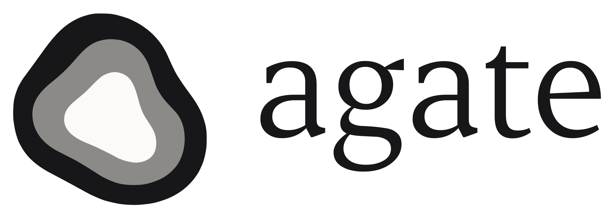

<p align="center">
  <picture>
    <source media="(prefers-color-scheme: dark)" srcset="docs/assets/agate-lockup-dark.svg">
    
  </picture>
</p>

<p align="center"><b>agate makes the price of compute tradable.</b><br>
An open onchain price for GPU-hours that anyone, whether a person, an app or an agent, can trade, hedge or build on.</p>

<p align="center">
  <a href="https://agate.elpabl0.xyz/app">App</a> ·
  <a href="https://agate.elpabl0.xyz/docs">Docs</a> ·
  <a href="docs/site/">Docs as markdown</a> ·
  <a href="https://agate.elpabl0.xyz/api/v1/prices">API</a> ·
  <a href="https://testnet.monadexplorer.com/address/0x419394b0Edf3d03164a7C06ea525cC1ED0e5Da36">Index on Monad</a> ·
  <a href="docs/judge.md">Claims a judge can check</a> ·
  <a href="LICENSE">MIT</a>
</p>

GPU rental prices move fast, and there is no open way to lock one in. Renters cannot hedge a rising compute bill,
GPU owners cannot protect their income, and there is no open, multi-source price for compute onchain. agate reads the
clouds' own price pages every hour, writes one checked price per GPU per day on Monad, and lists a monthly market on
each price: a Long that pays the month's average price, and a Short that locks it in, both fully backed, traded on
Kuru's order book. People sign in with an email and trade with no wallet and no gas; an AI trades from its own pocket
inside limits the person sets; developers read the same price from an API, an SDK or a contract.

<details>
<summary><b>For hackathon judges</b> · a three-minute tour, a 30-second onchain check, and where to look</summary>

<br>

**Try it (three minutes).** Open https://agate.elpabl0.xyz/app, sign in with an email code or Google (the first sign-in
adds 10,000 test dollars), go Long $100 on H100 November 2026, go Short with **Pay me daily**, close either, then open
the Index page to see every cloud's price beside the median. The full walk-through, with an AI connection:
[`JUDGES.md`](JUDGES.md).

**Check it onchain (30 seconds).** `curl https://agate.elpabl0.xyz/api/v1/prices` returns today's price per GPU
with each source beside it. The same numbers are written in the index contract
[`0x4193...5Da36`](https://testnet.monadexplorer.com/address/0x419394b0Edf3d03164a7C06ea525cC1ED0e5Da36), and any
contract can read it through a Chainlink-style feed, H100 at
[`0xC686...3D98`](https://testnet.monadexplorer.com/address/0xC68687dd7d7b40281FB07E9006538aa45fAF3D98)
(`latestRoundData()`, 6 decimals).

**Where to look.**
- The price: `contracts/src/AgateIndex.sol` and its libraries; the readers in `wall/packages/sources`; the Chainlink
  CRE workflow in `wall/apps/writer-cre`. Method: [How the price is made](docs/site/04-the-price.md).
- The market: `contracts/src/market/` (series, router, factory); the market maker and payer in `wall/apps/`.
- The AI door: `server/src/mcp/server.ts` (17 tools), `wallet/src/allowed.ts` (the pocket's onchain limits).
- Each sponsor (Chainlink CRE, Kuru, Envio, Dynamic, Alchemy) with transactions you can click: the sponsor table in
  [`JUDGES.md`](JUDGES.md) and [agate.elpabl0.xyz/docs/built-on](https://agate.elpabl0.xyz/docs/built-on).
- Every claim with its file and line: [`docs/judge.md`](docs/judge.md). What is not built yet:
  [Limits, stated](docs/site/16-limits.md).

</details>

## How it works

1. **A standard unit.** One GPU-hour of a defined GPU model, rented on demand.
2. **An open price.** For each GPU model, the clouds' public price pages are read every hour and combined into a
   median of companies. A Chainlink CRE workflow and a standby writer post the readings to Monad; a second,
   independent reader checks the same pages and must countersign every change, so no single key can move the price.
   Every source is shown beside the median, and the method is public: [How the price is made](docs/site/04-the-price.md).
3. **A cash-settled claim.** One token per GPU model per month pays the month's average index price, kept between a
   floor and a ceiling (half and twice the reference price). Holders are paid after the month, or daily if they
   choose. No GPUs change hands: [The monthly market](docs/site/05-the-market.md).

**What backs a token.** A token only comes into existence when someone locks the month's ceiling in dollars ($8.00 a
GPU-hour for H100 in November 2026). That deposit makes two sides: the token, worth the month's average price, and a
short unit, worth the ceiling minus that average. Together they always pay exactly the $8.00 that was locked, so every
dollar any holder can be paid is already in the contract: no margin calls, no liquidations, and no one can owe more
than they put in.

Six GPU models have a daily price: H100, H200, B200, B300, A100 and L40S. H100, H200 and B200 also have monthly
markets.

## Ways in

| Door | What it is | Docs |
|---|---|---|
| Web app | trade and hedge from a phone or desktop; email or Google sign-in, sponsored gas, test dollars | [Quickstart](docs/site/02-quickstart.md) |
| AI apps | a hosted MCP server: Claude, Codex, Hermes, OpenClaw and others read prices and trade from a pocket | [Connect an AI](docs/site/03-connect-an-ai.md) |
| Developer API | read-only JSON, no key: prices with sources, history, months, books, trades, candles | [Developer API](docs/site/08-api.md) |
| SDK | the TypeScript library the app runs on: reads, trades, call batches for smart accounts | [SDK](docs/site/10-sdk.md) |
| Contracts | the index itself, or a Chainlink-style feed per GPU | [Onchain feeds](docs/site/09-onchain.md) |

## Live on Monad testnet

| | Address |
|---|---|
| AgateIndex | [`0x419394b0Edf3d03164a7C06ea525cC1ED0e5Da36`](https://testnet.monadexplorer.com/address/0x419394b0Edf3d03164a7C06ea525cC1ED0e5Da36) |
| AgateFactory | [`0xEdBE3e696944443bBCe7eb3CD04E626e9396a0b5`](https://testnet.monadexplorer.com/address/0xEdBE3e696944443bBCe7eb3CD04E626e9396a0b5) |
| AgateRouter | [`0x4F4C14E7421dA83C398e04e4b5CeA2543f903c9c`](https://testnet.monadexplorer.com/address/0x4F4C14E7421dA83C398e04e4b5CeA2543f903c9c) |
| Test dollar (tUSD) | [`0x3A0513b2A19EE92eb3f73Dd06EefEe4D477CbF38`](https://testnet.monadexplorer.com/address/0x3A0513b2A19EE92eb3f73Dd06EefEe4D477CbF38) |

Every month's series, token and Kuru book: [Contracts and addresses](docs/site/12-contracts.md). All 20 live contracts
are verified on [Sourcify](https://sourcify.dev/#/lookup/0x419394b0Edf3d03164a7C06ea525cC1ED0e5Da36). The six price feeds:
[Onchain feeds](docs/site/09-onchain.md).
The index has run on the real calendar since Oct 4 2026. On Oct 8 a full pass passed: every package's tests, the live
services, a fork journey through a month's end, and a signed-in run on a real account, with Hermes and OpenClaw
calling agate's tools through a connector URL.

## Why Monad

- **An order book needs fast, cheap blocks.** Each month trades on Kuru's onchain order book; sub-second blocks let a
  person or an AI place, fill and close in seconds, and let the market maker requote cheaply.
- **The price is many small transactions.** Hourly readings from two writers, daily closes and countersigns cost
  little and land fast.
- **No wallet for the user.** Every person and every AI pocket is a ZeroDev Kernel smart account with sponsored gas,
  signed in through Dynamic, so a trade is one tap.
- **The ecosystem's stack:** Chainlink CRE writes the price, Kuru runs the books, Envio indexes everything over
  HyperSync, Alchemy carries the services' transactions. Where each sits in the code: [Built on](docs/site/15-built-on.md).

## Architecture

```
 clouds' price pages --hourly--> writers: Chainlink CRE workflow + standby --> AgateIndex (Monad)
                                  watcher -> attester (countersign) / guardian (veto)  ^
                                                                                       | final daily prices
 web app (Next.js, Dynamic, ZeroDev) --+                                               |
 AI apps (MCP, OAuth 2.1) --> agate server (Hono) --+--> router --> monthly series (one token per GPU per month)
 developers --> /api/v1 (read-only) ---------------+          \--> Kuru order books   <-- market maker, lister, payer
                                                  Envio HyperIndex (GraphQL) <-- every contract's events
```

Which process runs where, and how keys are held: [Architecture](docs/site/13-architecture.md).

**Stack:** Solidity 0.8.30 with Foundry; TypeScript on Bun (readers, writers, watcher, bots, server, SDK); Chainlink
CRE (TypeScript SDK); Next.js 16, React 19 and TanStack Query on Vercel; viem; Dynamic and ZeroDev; Kuru V1; Envio
HyperIndex; Hono and the MCP SDK; one Linux server for the always-on processes.

## Repository

| Folder | What it is |
|---|---|
| [`contracts/`](contracts/) | `AgateIndex`, the market (`src/market/`), the example feeds (`src/examples/`) |
| [`wall/`](wall/) | the price readers, both writers, the watcher, attester and keeper, guardian CLI, page check, repair agent, market maker, payer and lister |
| [`client/`](client/) | `@agate/client`, the SDK |
| [`wallet/`](wallet/) | `@agate/wallet`: Dynamic sign-in, smart accounts, the pocket's session key |
| [`server/`](server/) | MCP, OAuth 2.1, approvals, autopilot, the markets snapshot, the developer API |
| [`app/`](app/) | the web app |
| [`indexer/`](indexer/) | the Envio HyperIndex indexer |
| [`agents/`](agents/) | what an AI reads: `AGENTS.md`, `llms.txt`, a Claude plugin skill |
| [`ops/`](ops/) | the testnet operator kit and runbook, the server split, Dynamic's environment as code |
| [`docs/`](docs/) | the documentation ([`docs/site/`](docs/site/)) and the judge's claims |

```sh
bun install                                   # app, client, wallet and server (one bun workspace)
cd client && bun test                         # likewise in server/, wallet/, wall/ (bun install first)
cd contracts && forge test                    # after the two forge installs in contracts/README.md
```

Every package, its tests and the end-to-end runs: [Build and test](docs/site/14-develop.md).

## Limits

Testnet only, with test dollars. The index is the clouds' posted list prices, so it moves rarely and in steps. On
testnet it closes a day with one fresh source, and the CRE workflow runs in Chainlink's simulator (one node). The
books' depth comes from agate's own market maker. The contracts have had no outside audit. The full list:
[Limits, stated](docs/site/16-limits.md).

## Attribution

- **Price data:** each cloud's own public pricing page (Verda, Nebius, Lambda, CoreWeave, Civo, Hyperstack), read as
  published; the ECB's euro reference rates. GPU Economy (CC BY 4.0) and GPUTable are read only to check our readings,
  never as an input. Traded GPU prices from the Akash chain are shown for comparison only.
- **Code we build on:** OpenZeppelin Contracts (MIT) and forge-std (MIT/Apache-2.0); viem (MIT); Next.js, React and
  TanStack Query (MIT); Hono (MIT); the MCP TypeScript SDK (MIT); Dynamic's and ZeroDev's SDKs; the Chainlink CRE SDK
  (used as a dependency, not vendored); Envio (used as a dependency, not vendored). Kuru's contracts are called through
  interfaces that declare only the functions agate uses, from Kuru's public documentation and SDK.
- **Fonts:** Apfel Grotezk by Collletttivo (SIL OFL 1.1, self-hosted); Erode by the Indian Type Foundry (ITF Free Font
  License, loaded from Fontshare).

## Built with AI tools

agate was built with AI coding tools (Claude Code). The team directed the work, reviewed it and tested it, and every
change went through code review and the test suites.

## License

MIT, see [LICENSE](LICENSE).
